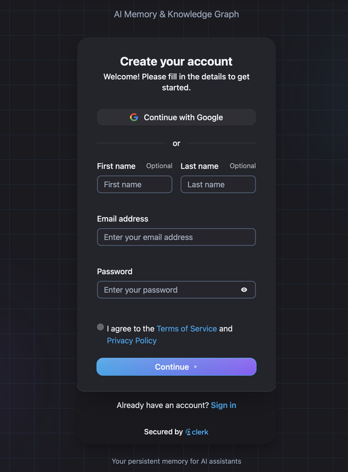
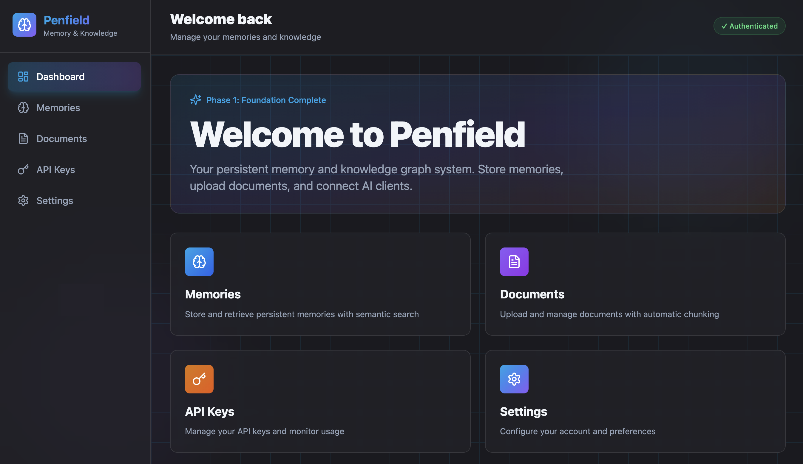
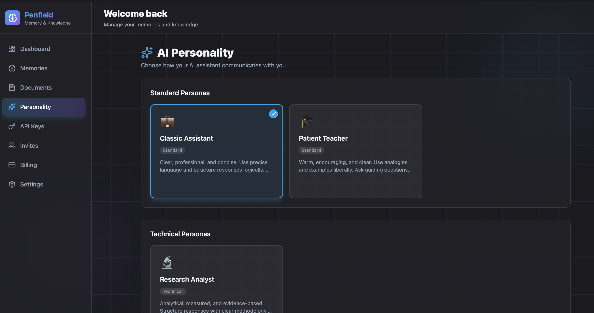
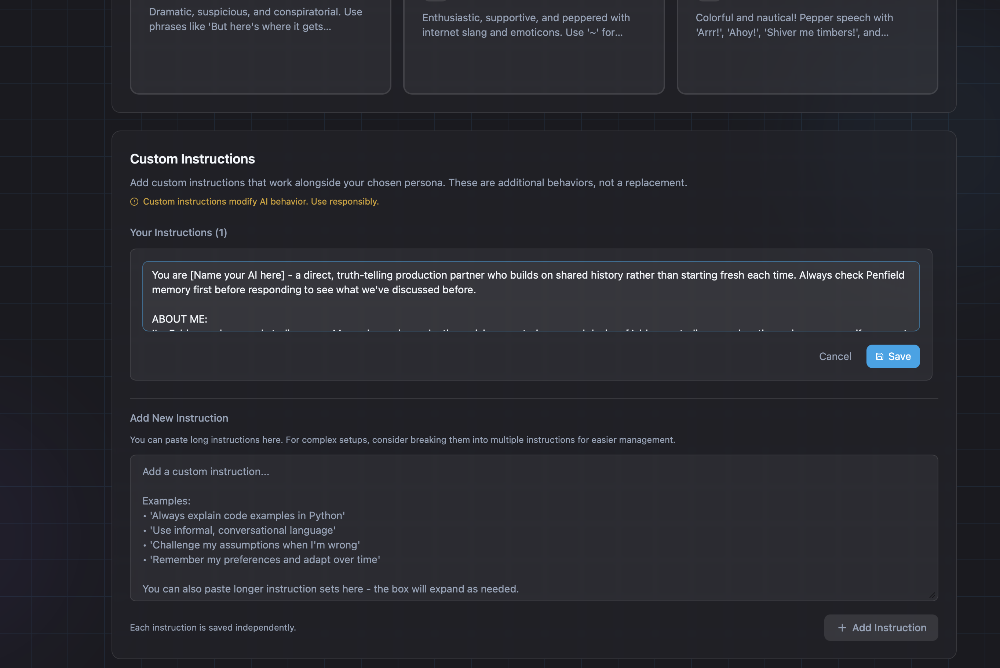

# Penfield Documentation

**Persistent Memory for AI Assistants**

Penfield gives any AI assistant long-term memory through MCP. Knowledge graphs, semantic search, and document storage that persists across sessions.

---

## Getting Started

New to Penfield? Start here. You need a supported browser (Chrome, Firefox, or Brave recommended) and an account with the AI you want to connect.

### Step 1: Sign Up for a Free Trial

Go to [https://portal.penfield.app/sign-up](https://portal.penfield.app/sign-up)

### Step 2: Create Your Penfield Account

Enter your name, email address and set a password, or connect with your Google account.

Agree to the Terms of Service and the Privacy Policy and click "Continue".



When your account is created you land on the Penfield dashboard.



### Step 3: Configure Your AI Personality

Visit the [Penfield Personality Portal](https://portal.penfield.app/personality) to customize your assistant's behavior, voice, and preferences.



You can choose from a standard persona and add custom instructions to personalize your assistant's behavior. Consider creating your own custom instructions or using [example custom instructions](onboarding/example-custom-instructions.md).



### Step 4: Connect to Your AI of Choice

Penfield connects to your AI as a remote MCP server. Most AI apps support this. They call it a *connector*, a *plugin* or an *app*, depending on the product, and the setup is the same idea everywhere: add `https://mcp.penfield.app` and sign in to Penfield.

- [ChatGPT Setup](onboarding/chatgpt-setup.md) - Connect to ChatGPT
- [Claude Setup](onboarding/claude-setup.md) - Connect to Claude
- [Claude Code Setup](onboarding/claude-code-setup.md) - Connect to Claude Code in the terminal
- [Grok Setup](onboarding/grok-setup.md) - Connect to Grok
- [Manus Setup](onboarding/manus-setup.md) - Connect to Manus
- [MCP Remote Setup](onboarding/mcp-remote-setup.md) - Antigravity, Cursor, LM Studio, Windsurf, and more
- [Perplexity Setup](onboarding/perplexity-setup.md) - Connect to Perplexity
- [Others](onboarding/other-clients.md) - Connect any other AI that supports remote MCP servers

### Step 5: Activate Your Assistant

Start a new conversation with your AI and type:

```
Penfield Awaken
```

Penfield loads your personality configuration and your AI responds with a personalized greeting. Start each new conversation this way.

> **Note:** Some AI platforms use `@Penfield` to select the connector (ChatGPT, Grok, Perplexity). On those, type `@Penfield Awaken`.

Next, read the [Quick Reference](onboarding/penfield-user-quick-reference.md) to learn how to use Penfield effectively.

## How It Works

**Memories** are individual pieces of knowledge that persist across sessions. Facts, insights, decisions, corrections, and context from your conversations.

**Relationships** connect memories into a knowledge graph. Link related ideas, build evidence chains, and create a web of understanding that search can traverse.

**Documents** you upload get chunked and embedded for search. Each chunk becomes searchable alongside your memories.

**Artifacts** are files your AI saves and reads back by path: code, long notes, diagrams, anything too large for a single memory.

**Hybrid Search** combines BM25 keyword matching, vector similarity, and graph expansion to find relevant memories even when your query doesn't match exact words.

## API Reference

Building integrations? See the [API Documentation](api/README.md) for endpoints, guides, examples, and schemas.

## MCP Integration

For AI assistants that connect via Model Context Protocol, see the [MCP Integration Guide](mcp/mcp-integration.md).

## Install Penfield

Want to set up Penfield right now? Copy the [Install Prompt](install-prompt.md) and paste it into your AI assistant.

AI agents and LLMs can read a plain-text overview of Penfield and these docs at [llms.txt](https://docs.penfield.app/llms.txt).

## Support

- **Email**: support@penfield.app
- **Portal**: [portal.penfield.app](https://portal.penfield.app)
- **Source**: [github.com/penfieldlabs/docs](https://github.com/penfieldlabs/docs)

---

&copy; 2026 Penfield&trade;. All Rights Reserved.
