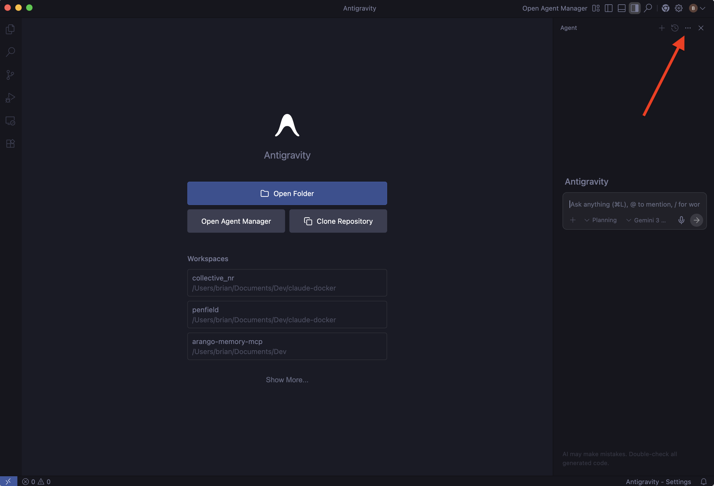
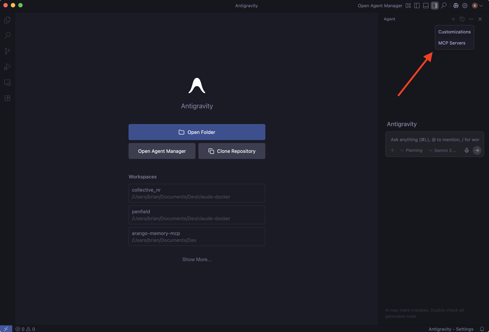
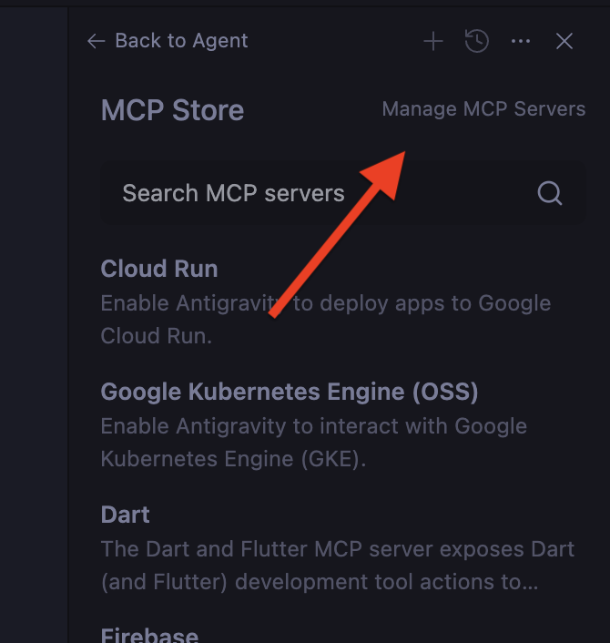
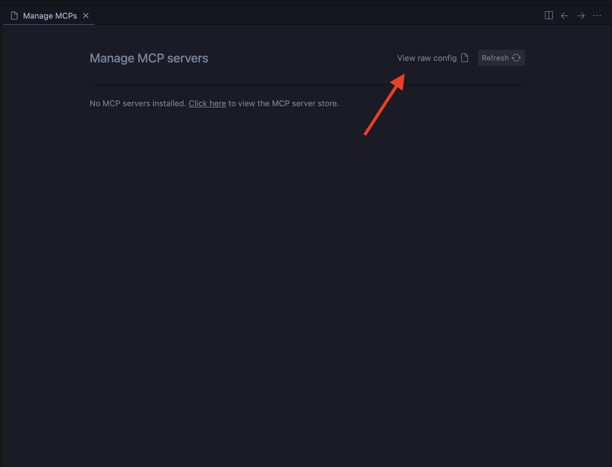

# Antigravity Setup

Connect Penfield to Google Antigravity as a remote MCP server to enable persistent memory and personality features in your Antigravity sessions.

Antigravity connects to Penfield directly and signs you in through your browser. There is nothing to install.

> **Already connected through mcp-remote?** Earlier versions of this guide used `mcp-remote`. Replace that entry in your configuration with the one in [Step 2](#step-2-add-penfield), then sign in as described in [Step 3](#step-3-sign-in).

## Prerequisites

- A Penfield account ([sign up here](https://portal.penfield.app/sign-up) if you haven't already)
- Antigravity: the app, the IDE or the CLI. They share one MCP configuration, so you set Penfield up once

---

## Step 1: Open the MCP Configuration

In the Antigravity IDE, go to the Agent panel on the right side of the screen and click the **three-dot menu** (**⋯**).



From the dropdown menu, click **MCP Servers**.



In the MCP Store panel, click **Manage MCP Servers** in the top right.



Click **View raw config** to open the configuration file.



This opens `mcp_config.json`. You can also open the file yourself: it is at `~/.gemini/config/mcp_config.json` (on Windows, `%USERPROFILE%\.gemini\config\mcp_config.json`).

---

## Step 2: Add Penfield

Add the Penfield entry and save the file:

```json
{
  "mcpServers": {
    "penfield": {
      "serverUrl": "https://mcp.penfield.app"
    }
  }
}
```

> **Note:** If you already have other MCP servers configured, add the `"penfield": { ... }` block inside your existing `"mcpServers"` object. Don't create a second `"mcpServers"` key.

**Using the Antigravity CLI?** One command does Steps 1 and 2:

```bash
agy mcp add penfield https://mcp.penfield.app
```

---

## Step 3: Sign In

Penfield now appears in your list of MCP servers, marked as needing sign-in.

1. Open the list of MCP servers and start the sign-in:
    - **App and IDE:** go to **Customizations** > **Installed** > **MCP Servers** and click **Authenticate** next to **penfield**
    - **CLI:** type `/mcp`, select **penfield**, press Enter and choose **Authenticate**
2. Antigravity shows a link. Open it in your browser.
3. Sign in to your Penfield account if asked, then click **Authorize**.
4. The browser shows an authorization code. Copy it, paste it into Antigravity and confirm.

Penfield is then listed as signed in, together with its tools. Antigravity registers itself with Penfield automatically. You do not need a client ID, a secret or an API key.

---

## Step 4: Activate Your Assistant

Start a new conversation and type:

```
Penfield Awaken
```

Penfield will load your personality configuration and respond with a personalized greeting. Start each new conversation this way.

When Antigravity asks for permission to use a Penfield tool, allow it. Choosing the "always allow" option is up to you, of course, but it lets your assistant use its memory seamlessly, without asking each time.

---

## Support

If you encounter issues, contact [support@penfield.app](mailto:support@penfield.app).
