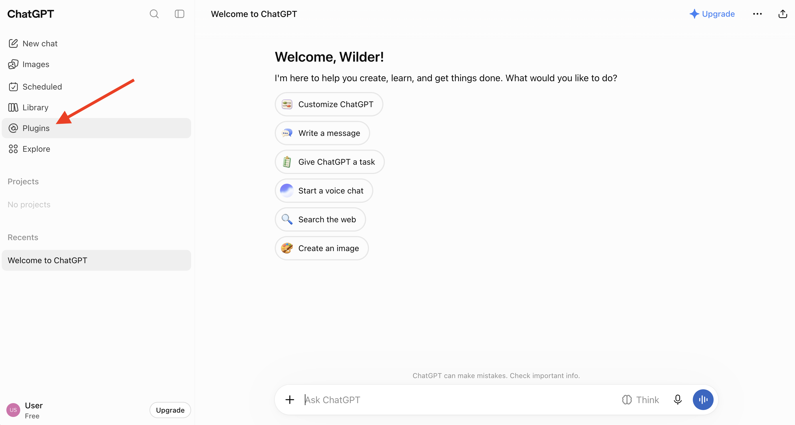
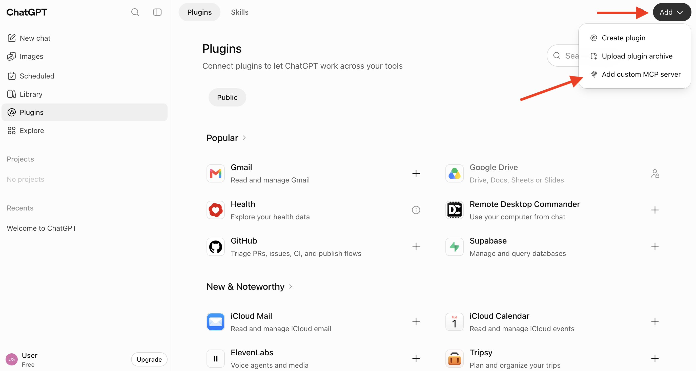
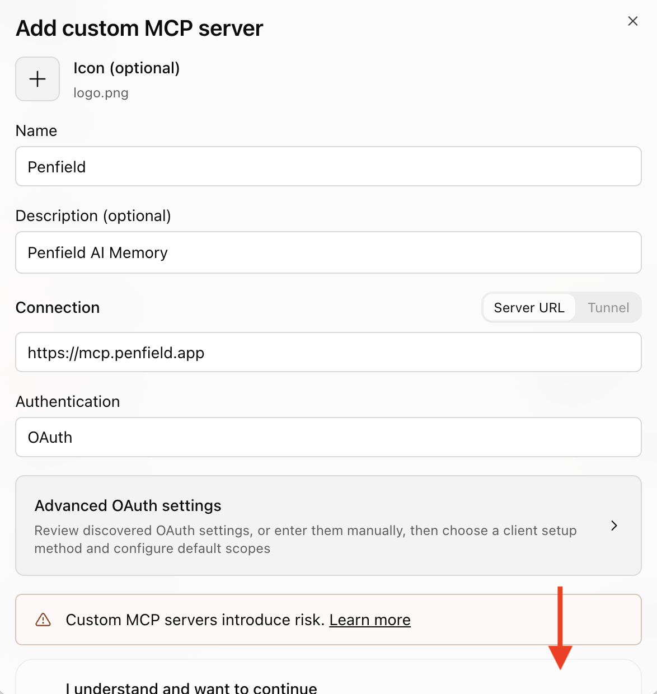
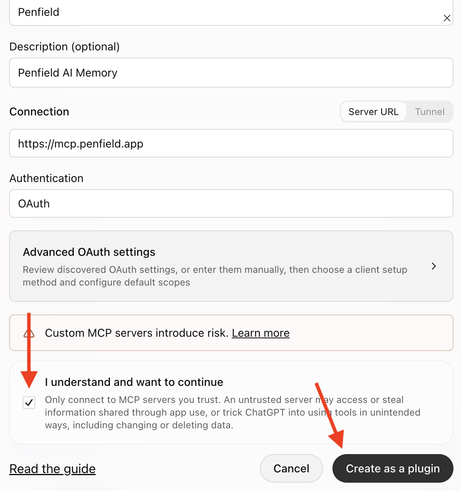
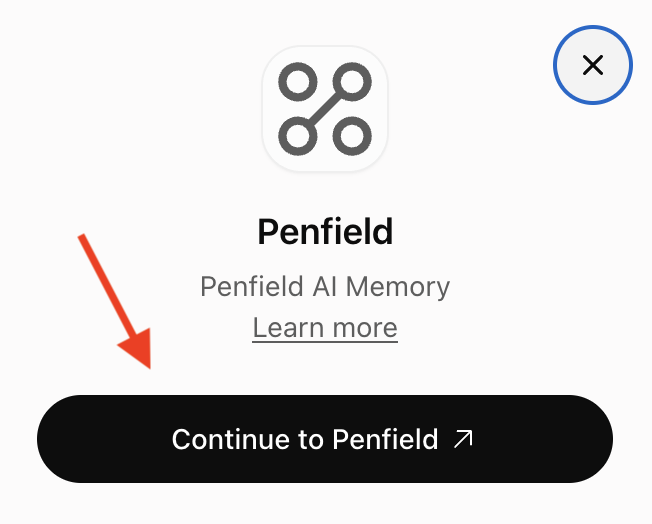
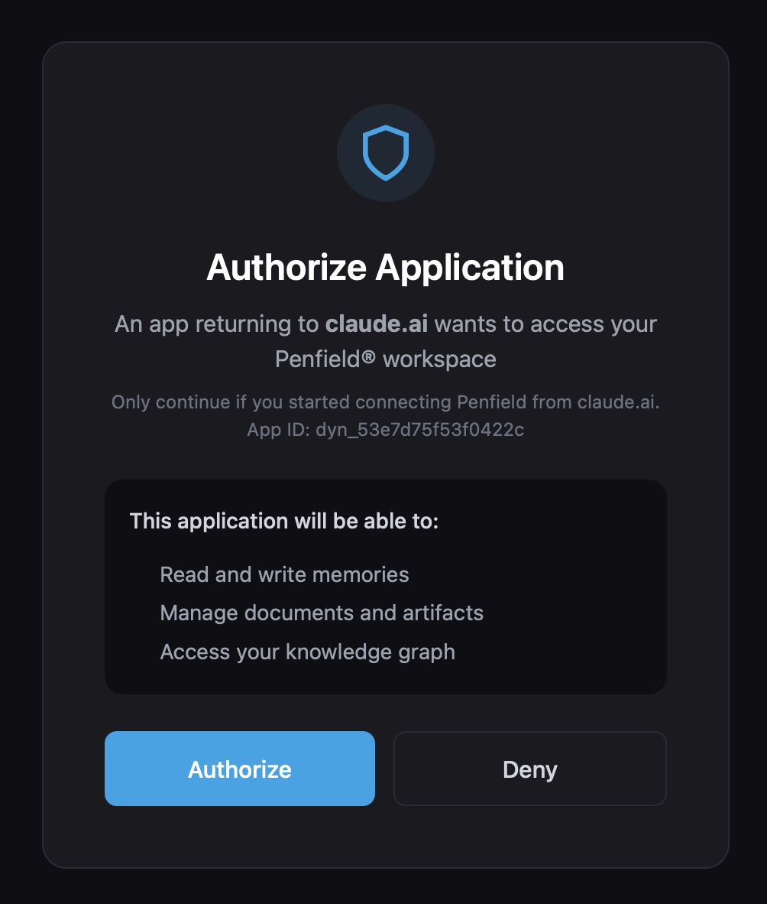
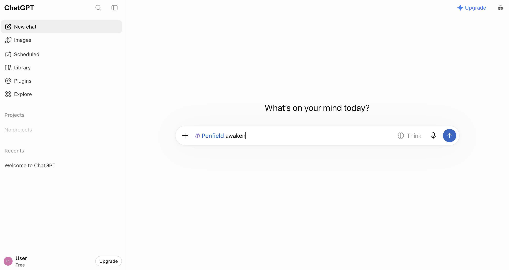
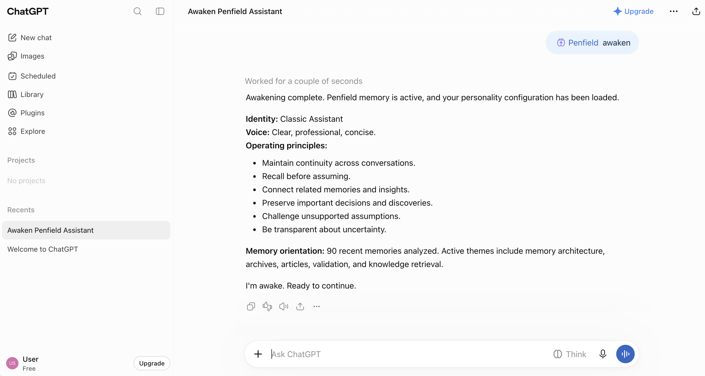

# ChatGPT Setup

Connect Penfield to ChatGPT to enable persistent memory and personality features in your ChatGPT conversations.

## Prerequisites

- A Penfield account ([sign up here](https://portal.penfield.app/sign-up) if you haven't already)
- A ChatGPT account. A free account works

---

## Step 1: Open Plugins

Click **Plugins** in the left sidebar of ChatGPT.



---

## Step 2: Add a Custom MCP Server

Click **Add** in the top-right corner, then click **Add custom MCP server**.



---

## Step 3: Enter the Penfield Details

Fill in the Add custom MCP server form:

| Field | Value |
|-------|-------|
| **Name** | `Penfield` |
| **Description (optional)** | `Penfield AI Memory` |
| **Connection** | Server URL |
| **Server URL** | `https://mcp.penfield.app` |
| **Authentication** | OAuth |

Optionally, click the **+** next to **Icon** and upload the Penfield logo. You can download it from `https://docs.penfield.app/logo.png`.



---

## Step 4: Create the Plugin

Scroll down. Check the **"I understand and want to continue"** box, then click **Create as a plugin**.



---

## Step 5: Continue to Penfield

Click **Continue to Penfield**.



---

## Step 6: Authorize the Connection

A Penfield page opens. Sign in to your Penfield account if asked, then click **Authorize** to connect your Penfield workspace to ChatGPT.



The page looks the same for every app. It names the app you are connecting from.

---

## Step 7: Activate Your Assistant

Start a new chat in ChatGPT and type:

```
@Penfield awaken
```

Typing `@Penfield` selects the Penfield plugin for the message.



Penfield will load your personality configuration and respond with a personalized greeting. Start each new chat this way.



---

## Support

If you encounter issues, contact [support@penfield.app](mailto:support@penfield.app).
