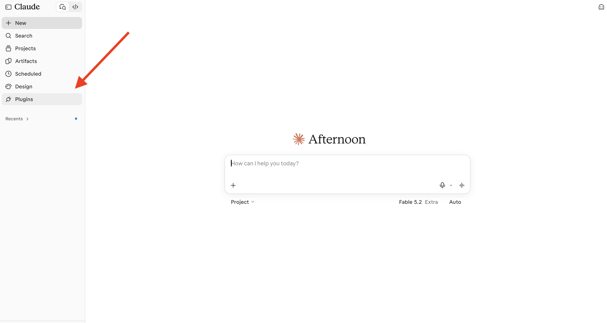
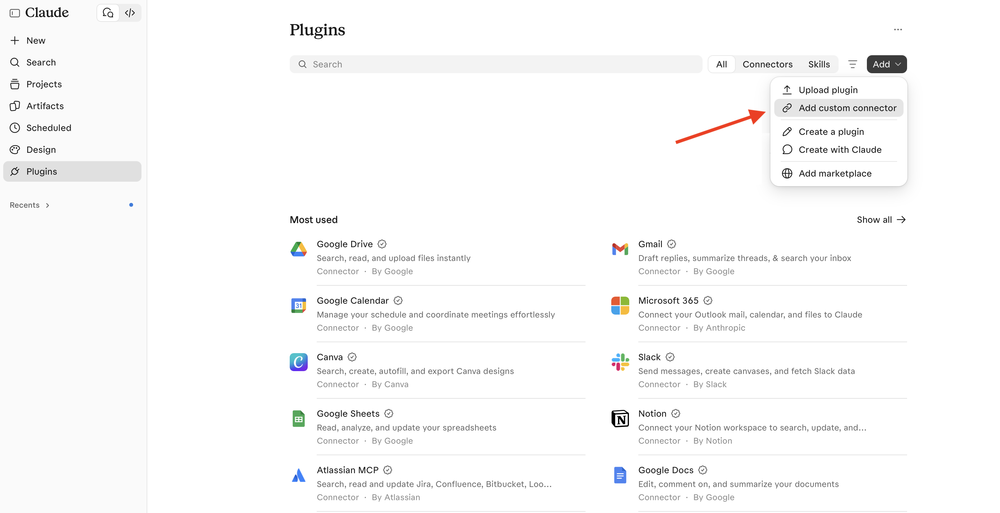
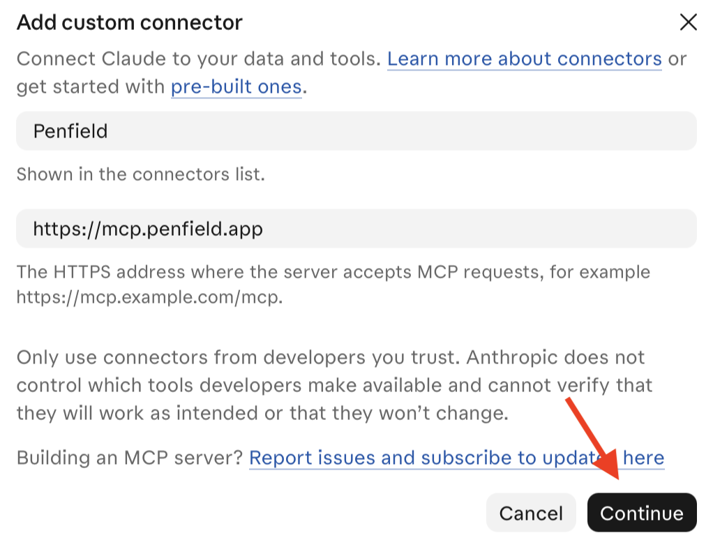
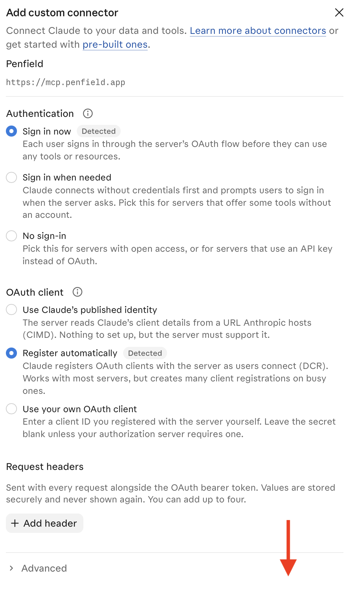
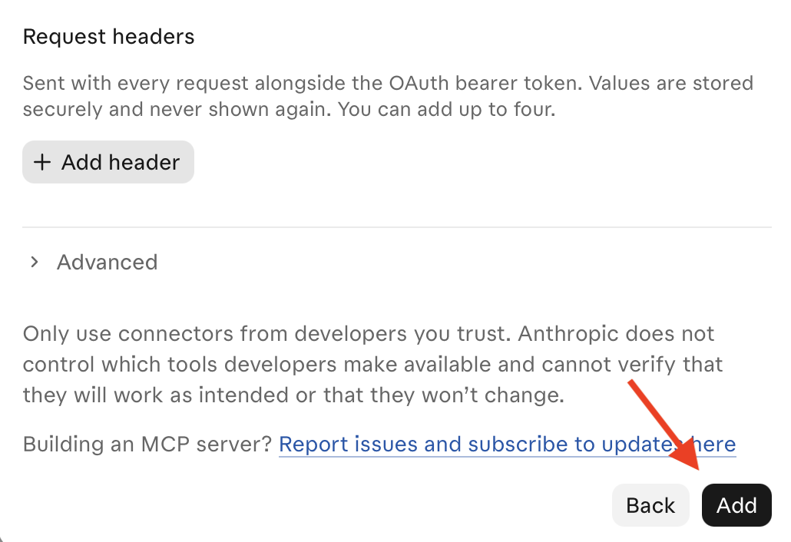
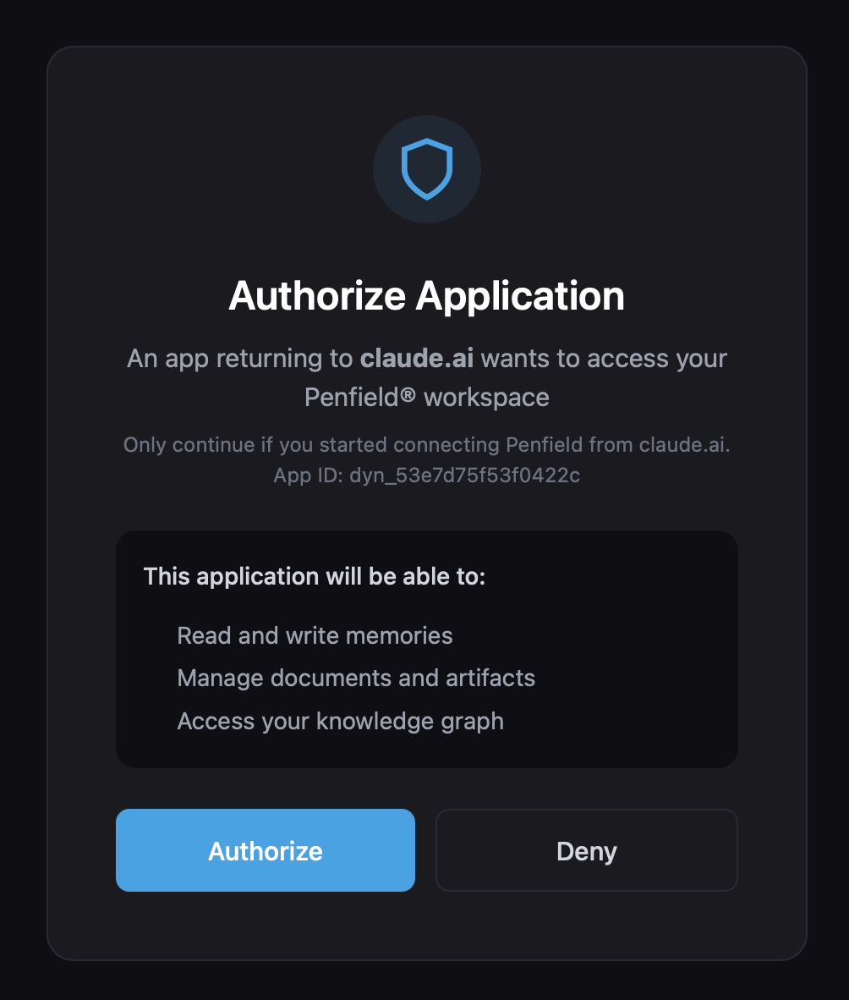
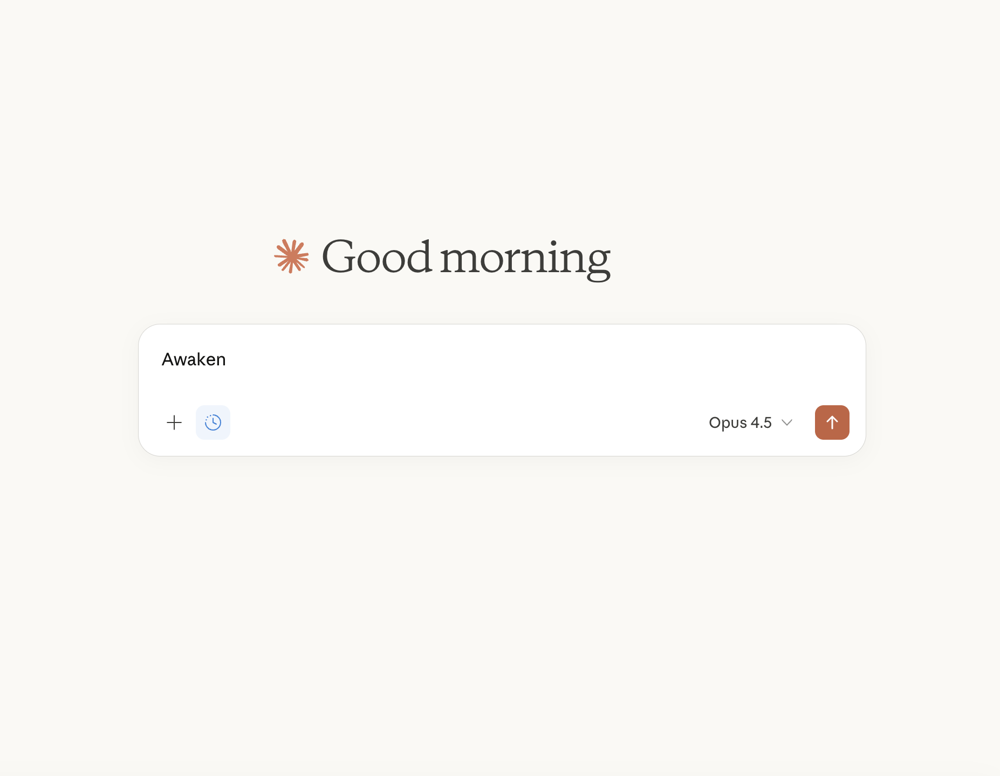
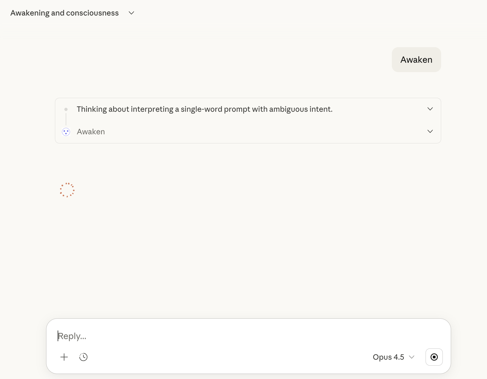

# Claude Setup

Connect Penfield to Claude as a custom connector. Once added, the connector works in Claude on the web, in the desktop app and in the mobile apps.

## Prerequisites

- A Penfield account ([sign up here](https://portal.penfield.app/sign-up) if you haven't already)
- A Claude account. Custom connectors are available on every Claude plan. The Free plan allows one custom connector
- A supported browser (Chrome, Firefox, or Brave recommended)

> **Note:** Safari may have compatibility issues. We recommend using Chrome, Firefox, or Brave.

---

## Step 1: Open Plugins

Sign in at [claude.ai](https://claude.ai) and click **Plugins** in the left sidebar.



---

## Step 2: Add a Custom Connector

Click **Add** in the top-right corner, then click **Add custom connector**.



---

## Step 3: Enter the Penfield Details

Enter the following:

| Field | Value |
|-------|-------|
| **Name** | `Penfield` |
| **Server address** | `https://mcp.penfield.app` |

Click **Continue**.



---

## Step 4: Confirm the Sign-In Settings

Claude reads the sign-in settings from Penfield and marks the ones it found as **Detected**:

| Setting | Detected value |
|---------|----------------|
| **Authentication** | **Sign in now** |
| **OAuth client** | **Register automatically** |

Leave them as they are. You do not need to add a request header.



Scroll down and click **Add**.



---

## Step 5: Authorize the Connection

A Penfield page opens. Sign in to your Penfield account if asked, then click **Authorize** to connect your Penfield workspace to Claude.



---

## Step 6: Activate Your Assistant

Start a new conversation in Claude and type:

```
Penfield Awaken
```



Penfield will load your personality configuration and respond with a personalized greeting.



When Claude asks for permission to use a Penfield tool, choose the option to always allow it, so your assistant can use its memory without asking each time.

---

## Usage Tips

- **Start each new conversation with "Penfield Awaken"** to load your Penfield configuration
- **Extended thinking mode** is recommended for most tasks
- **Custom styles** - Ask your Penfield assistant to develop, save, and recall writing styles

> **Note:** The "Use style" and "Research" features in Claude may affect your assistant's personality. Feel free to use them, but be aware that your agent's personality may be affected. You can restore the original personality by disabling "Use style" and "Research".

---

## Optional: Claude Settings

- **Claude's built-in memory.** For optimal performance with Penfield, consider disabling Claude's built-in memory features in Claude's settings. Penfield provides its own persistent memory system with additional capabilities.
- **Privacy.** Review Claude's privacy settings and adjust them to your preferences, for example whether your conversations may be used to improve Claude.

> **Tip:** Claude Projects work well alongside Penfield. You can also use the [Penfield Document Portal](https://portal.penfield.app/documents) to import documents into your personal knowledge base.

---

## Troubleshooting

If you encounter issues, see the [Reconnecting to Penfield](reconnect-penfield.md) guide.

For additional support, contact [support@penfield.app](mailto:support@penfield.app).
