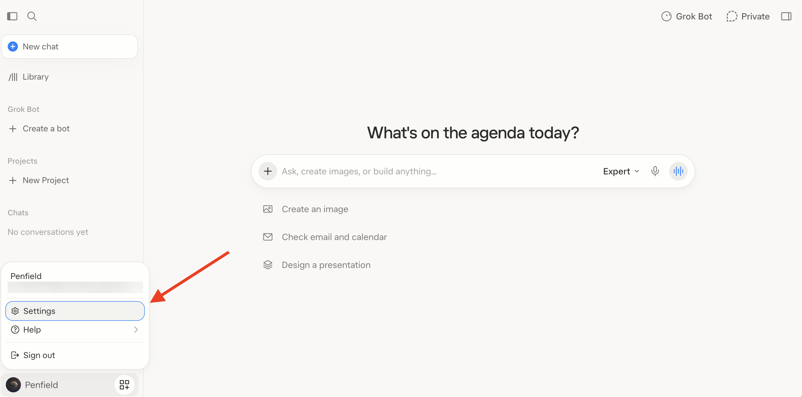
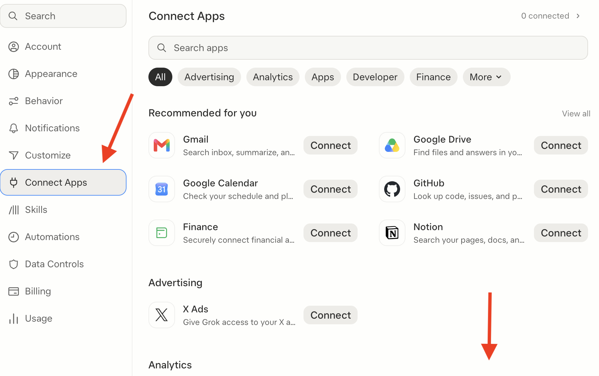
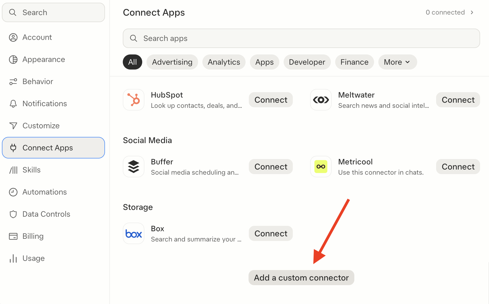
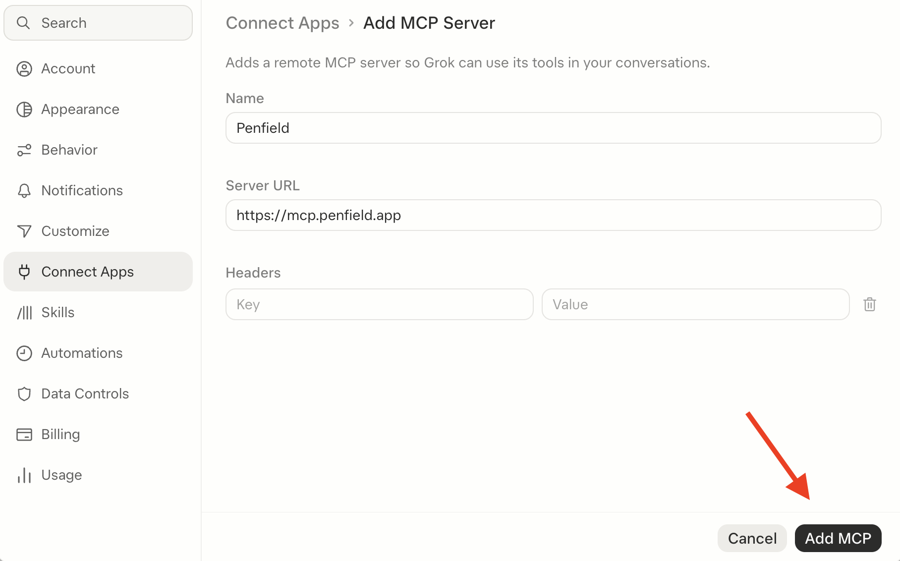
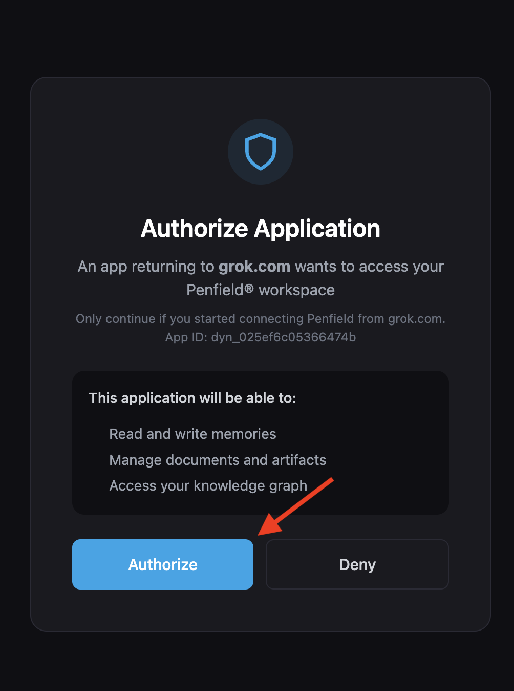
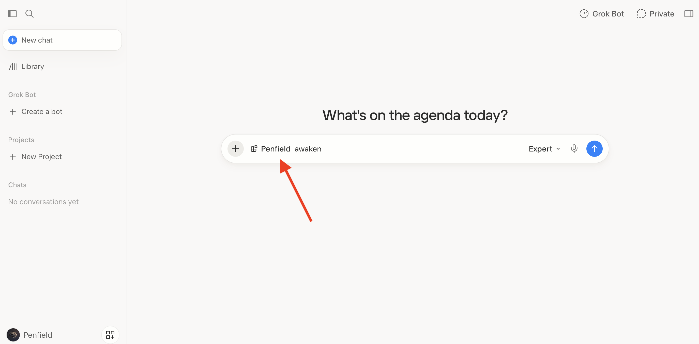

# Grok Setup

Connect Penfield to Grok as a custom connector to enable persistent memory and personality features in your Grok conversations.

## Prerequisites

- A Penfield account ([sign up here](https://portal.penfield.app/sign-up) if you haven't already)
- A Grok account at [grok.com](https://grok.com)

---

## Step 1: Open Grok Settings

Click your name in the bottom-left corner of Grok, then click **Settings**.



---

## Step 2: Open Connect Apps

Click **Connect Apps** in the left sidebar, then scroll to the bottom of the list.



---

## Step 3: Add a Custom Connector

At the bottom of the list, click **Add a custom connector**.



---

## Step 4: Add the Penfield MCP Server

Fill in the Add MCP Server form:

| Field | Value |
|-------|-------|
| **Name** | `Penfield` |
| **Server URL** | `https://mcp.penfield.app` |
| **Headers** | Leave empty |

Click **Add MCP**.



---

## Step 5: Authorize the Connection

A Penfield page opens. Sign in to your Penfield account if asked, then click **Authorize** to connect your Penfield workspace to Grok.



---

## Step 6: Activate Your Assistant

Start a new chat in Grok and type:

```
@Penfield awaken
```

Typing `@Penfield` selects the Penfield connector for the message.



Penfield will load your personality configuration and respond with a personalized greeting. Start each new chat this way.

---

## Support

If you encounter issues, contact [support@penfield.app](mailto:support@penfield.app).
